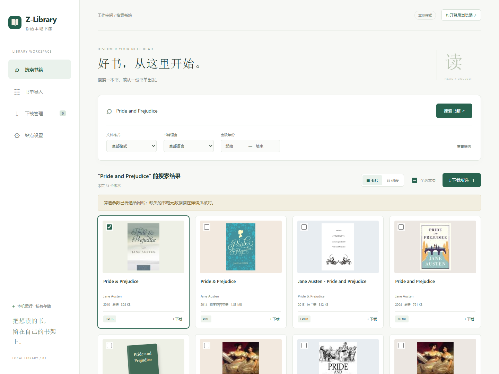
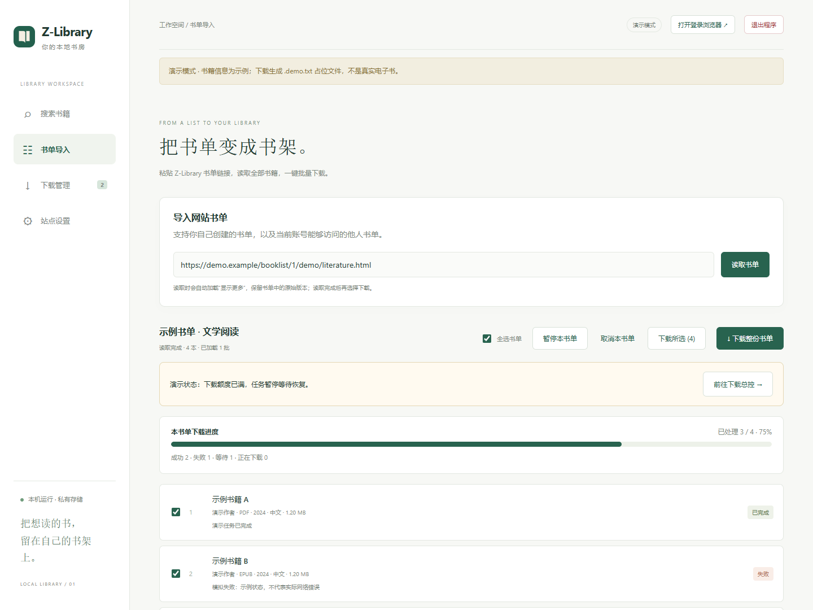
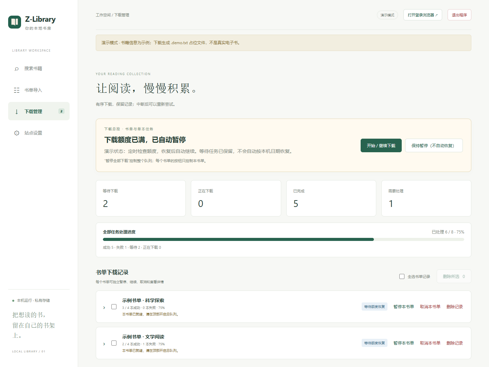

# Z-Library 本地书房

本机运行的电子书搜索、书单导入与下载管理工具。Node.js + 原生网页界面 + Playwright，无前端构建步骤。

A local, browser-assisted ebook download manager with persistent queues and per-booklist controls.

> 非官方独立项目，与 Z-Library 无隶属或合作关系。仅用于你有权获取的内容；不会绕过登录、验证码、访问权限或下载额度。网站可访问性与额度以网站实际显示为准。仓库不提供电子书、账号、Cookie 或已登录浏览器配置。

## 功能预览

### 搜索书籍



### 书单导入



### 下载管理



搜索图保留用户指定的实际搜索界面。书单导入和下载管理图使用隔离的固定演示数据，书单名称、链接、书籍、下载统计与额度状态均为示例，不读取真实账号或下载记录。截图仅展示界面功能，不代表网站当前可用性、真实额度或下载速度。

- 按书名、作者、ISBN 搜索，按格式、语言、年份筛选；卡片 / 列表视图、封面回退。
- 网站书单分批读取；可添加多个书单，分别暂停、继续、取消或删除记录。
- 同时下载数可配置为 1–3；Chrome 文件流回退最多 2 路，受总并发限制。
- 按书单名称建立子目录，复用已有目录，检查已有文件，避免重复下载。
- 文件命名为 `书名(作者)-年份.扩展名`，缺失信息自动省略；不覆盖已有文件。
- 下载目录可配置；新任务使用新目录，历史任务保留原路径。
- 下载记录持久化；重启后默认暂停，失败可查看原因、搜索同名版本或重试。
- 文件流使用临时文件和原子保存；显示实际接收字节，支持取消与有界超时。

下载启动同时监听原页面及本次操作打开的子页面，避免弹窗已下载却被误判启动超时。Chrome 原生下载期间显示等待浏览器完成；不会用临时目录里其他文件的大小猜测当前书籍的进度。Node 直连和 Chrome 分块传输仍显示接收字节。

## 环境与快速开始

主要在 Windows 上开发和验证。需要安装 Google Chrome 或 Microsoft Edge，以及 Node.js 22 或更新版本；建议 Node.js 24.14+，以使用当前实现的动态 HTTP/HTTPS 代理接口。未在 macOS/Linux 验证完整的真实浏览器下载流程。

从仓库下载并解压源码后，在项目目录执行：

```powershell
npm ci
npm run start:background
```

Windows 也可双击 `start.bat`：它会检查 Node.js、在需要时安装依赖，并启动独立后台服务。默认网页地址为 [http://127.0.0.1:3210](http://127.0.0.1:3210)，端口不可用时会寻找附近空闲端口，以启动输出的地址为准。

1. **启动后先登录。** 打开本地书房网页，先点击右上角的「打开登录浏览器」。在软件打开的浏览器窗口里登录你的 Z-Library 账号，按网站提示完成验证，再回到本地书房。
2. 在「站点设置」确认 HTTPS 站点地址、下载目录、浏览器运行方式和并发数。
3. 搜索书籍，或在「书单导入」粘贴当前站点的完整书单链接，读取并加入队列。
4. 到「下载管理」顶部点击「开始 / 继续下载」。登录验证不会自动启动队列。
5. **用完后点「退出程序」。** 点击本地书房网页右上角的「退出程序」并确认，安全停止后台服务并保留下载记录。直接关闭网页或启动窗口，后台下载仍会继续。

程序不会注册系统服务、任务计划或开机自启，也不会崩溃后无限自动重启。

前台调试：`npm start`，退出可按 Ctrl+C。配置端口或自定义浏览器：

```powershell
$env:PORT = '3211'
$env:BROWSER_PATH = 'C:\Program Files\Google\Chrome\Application\chrome.exe'
npm start
```

### 不登录的演示模式

```powershell
npm run demo
```

使用 `Pride`、`Walden`、`红楼梦` 或 `a` 搜索。演示模式只生成明确标记的 `.demo.txt` 占位文件，不下载真实电子书；状态与真实模式分开保存。

## 下载总控与单书单操作

- **顶部总控**：「开始 / 继续下载」「暂停全部下载」控制所有书单和单本任务。
- **书单按钮**：「暂停本书单 / 继续本书单」只改变这一书单，不影响其他书单。
- 总队列暂停时，书单局部恢复显示为「解除本书单暂停」，解除后仍需开启顶部总控。全局继续不会恢复单独暂停的书单。
- 状态区分「随总队列暂停」「本书单已暂停」「排队中」。导入页提供「前往下载总控」入口。
- 暂停会中断当前相关传输并保留待继续任务；没有字节级断点续传，恢复时可能重新传输该文件。

书单单次最多读取 5000 本；网络异常、停止或达到上限时保留已读取结果。如果网站总数与分页返回数量不同，会显示差异，不能把没返回的资源视为已下载。TXT / CSV 匹配入口支持每批最多 200 本、输入最多 1 MB，示例见 [examples/](examples/)。

进度的「已处理」包含成功、失败和取消，100% 不等于全部成功。文件去重使用名称、大小与格式签名检查，不等同于原站提供的完整文件校验和认证。

## 本地数据与隐私

### 额度耗尽与自动暂停

网站账号面板的“已下载次数 / 当日限额”达到上限（例如 999/999），或页面明确提示每日下载额度用完时，自动暂停整个账号队列的新下载请求。触发任务和后续任务保留为等待，不会逐本等待启动超时或批量标成失败。已接收字节的并发文件允许保存完成；需要主动停止它们时，可点“暂停剩余传输”。

HTTP 429 也会自动暂停，但显示为“网站限制请求”，不直接认定每日额度已满。普通 403、502/503/504/522、启动超时或仅提示“请检查额度”不会据此误判。加入新书单、单书单继续或单本重试都不会绕过账号暂停；网站额度恢复后，在顶部点击“开始 / 继续下载”并确认。

暂停原因保存在任务记录及相邻的队列状态文件，重启后继续保留；不会根据电脑的午夜或未经确认的时区自动恢复。以前已失败的历史记录不自动重排。本地测试覆盖计数、弹窗、HTML 响应、Node/Chrome 通道和并发保护；实际站点页面如变化，仍需核对识别，不保证仅凭截图就是已完成现场验证。

可在“站点设置 → 额度恢复后自动继续”开启自动恢复（默认关闭），并设置 5–1440 分钟的检查间隔，默认 30 分钟。程序运行期间，只有因每日额度用完而自动暂停、且仍有可运行任务时才后台读取新页面，不通过试下载探测。明确读到已用次数小于每日限额，且每日限额与暂停时的账号一致，才自动继续；没有原限额记录、疑似游客额度、需要验证、HTTP 429 或网站异常时保持暂停。下载管理会显示检测状态与下次检查时间；点击“保持暂停（不自动恢复）”可取消本轮自动恢复，单独暂停的书单不会被解除。退出后不检查，重启后保留额度暂停原因和设置，再等待一个检查间隔。

如果现有队列是手动暂停，仅开启设置不会接管它。可明确点击“让当前队列等待额度恢复”并确认：读取到最新额度确实已满后，保留任务原状，记录限额并开启定时检查，不尝试下载任何书籍。未完成验证或网站异常时此操作不会改变队列；额度已经可用时提示手动继续，而不是擅自开始下载。

| 内容 | 默认位置 |
| --- | --- |
| 真实下载 / 演示占位文件 | `downloads/books/` / `downloads/demo/` |
| 设置、队列、最近读取书单 | `.data/live/` / `.data/demo/` |
| 独立浏览器会话 | `.data/live/browser-profile-*/` |
| 启动和运行日志 | `.data/live/logs/` |

本地服务只监听 `127.0.0.1`，不要通过代理或端口转发公开到互联网。日常浏览器的账号、扩展和个人资料不会自动共享。登录会话是敏感数据，不得分享；外置下载目录同样不能上传。

Node 文件传输可使用显式 HTTP/HTTPS 环境代理，或当前 Windows 手动代理；不修改系统设置。PAC/SOCKS 或旧 Node 不支持时保留 Chrome 回退。不要关闭 TLS 校验来解决网络问题。

上述运行数据、下载文件、日志、测试截图和本地备份已被忽略。分享报错前必须检查日志正文并脱敏，尤其是 Cookie、Authorization、签名 URL、个人路径和书单记录。详见 [SECURITY.md](SECURITY.md)。

### 下载记录损坏时的恢复

队列和状态文件写入临时文件并刷盘后再替换，旁边的 `.bak` 保留上一版（不保证包含最新变更）。如果主文件缺失或 JSON 损坏，启动时优先使用完整备份；没有可用备份时，仅恢复数组开头连续、完整且格式有效的记录，不猜测损坏尾部。无法恢复任何记录时会显示空队列及警告，不把它当作正常首次启动。

覆盖前会将损坏原件原样复制到相邻的 `.corrupt-时间-随机编号` 文件。恢复后显示明确提示，整个队列保持暂停，额度自动恢复也不能绕过；新建任务或单本重试仍需在下载管理顶部点击“开始 / 继续下载”确认。恢复提示在重启后保留，直到手动继续。已保存的电子书不会因记录恢复被删除；缺失的记录可能需要重新导入书单核对，不能承诺恢复所有历史。

`.bak` 和 `.corrupt-*` 同样含有私人使用记录，只留在已忽略的本地数据目录，不要上传到 GitHub。刷盘和备份降低损坏风险，但不能代替系统备份或保证断电、磁盘故障下的数据完整性。

## 常见问题与限制

- HTTP 522 表示文件服务侧连接源站超时；502/503/504 等临时错误会有限重试，不保证站点恢复。
- 大文件耗时取决于网络、代理与服务器；没有固定提速保证。Node 和 Chrome 路径均有超时保护，失败不留下可误认为完整文件的临时产物。
- 登录与验证仍需人工处理；额度可选择确认恢复后自动继续，不支持验证码识别、权限绕过、格式转换、XLSX 导入或字节级断点续传。
- 后台模式仍需专用浏览器运行；登录和验证窗口是有意显示的。浏览器更新或网站改版可能影响兼容性。
- 删除下载记录不删除已保存文件。不要用清理工具或测试脚本直接操作正在使用的队列。

## 开发与测试

```powershell
npm ci
npm run check
npm test
npm run test:release
npm run test:queue-controls
npm run test:adapter
npm run test:booklist
npm run test:download
npm run test:quota
```

核心测试不需要登录。后三项和 UI 测试需要本机 Chrome；分页和文件流测试使用隔离的本地 fixture，不下载网站书籍。`test:queue-controls` 不连接生产服务。

`npm run test:ui` 会修改目标演示队列；只能对单独启动的演示服务运行，可用 `TEST_ORIGIN` 指定地址。不得对真实队列运行。更多说明见 [CONTRIBUTING.md](CONTRIBUTING.md)。

CI 配置执行语法检查、核心回归及发布审查；尚未在远程 GitHub 执行，不代表已验证所有平台或真实网站。

## 文档与发布

- [技术交接与维护边界](docs/HANDOFF.md)
- [通俗设计复盘](docs/TECHNICAL_BLOG.md)
- [实现细节](docs/TECHNICAL_BLOG_DEEP_DIVE.md)
- [GitHub 发布步骤与隐私检查](docs/RELEASING.md)
- [第三方依赖说明](THIRD_PARTY_NOTICES.md)

`npm run release:check` 审查待发布文件；`npm run release:prepare` 创建不包含 Git 历史、运行数据或依赖目录的干净源码目录与 ZIP。历史中可能仍有旧个人文档，首次公开建议从干净包创建新仓库，不直接推送本地完整历史。

## 许可证

本项目源码采用 [MIT License](LICENSE)。第三方依赖保留各自许可证；该授权不包含网站内容、电子书或第三方商标的使用授权。包中的 `private: true` 仅防止意外发布到 npm，不妨碍在 GitHub 公开源码。
