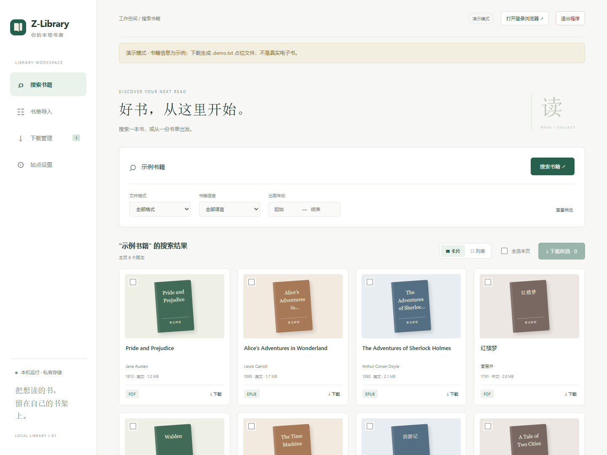
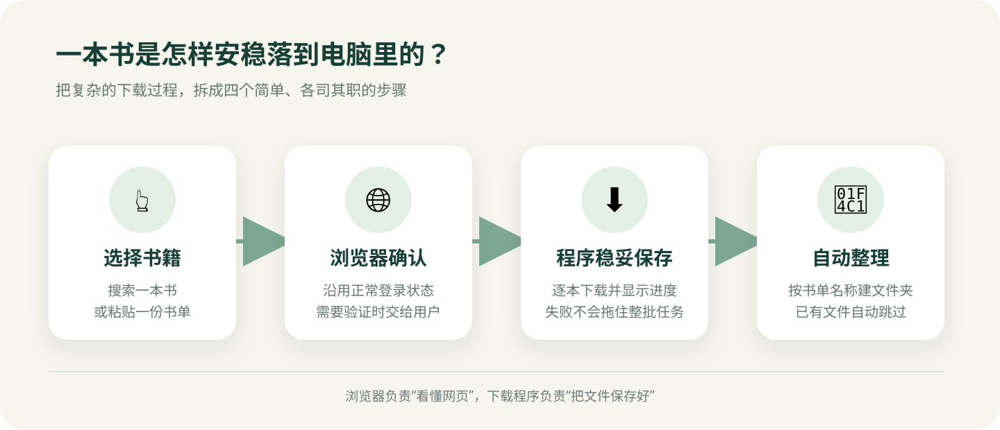
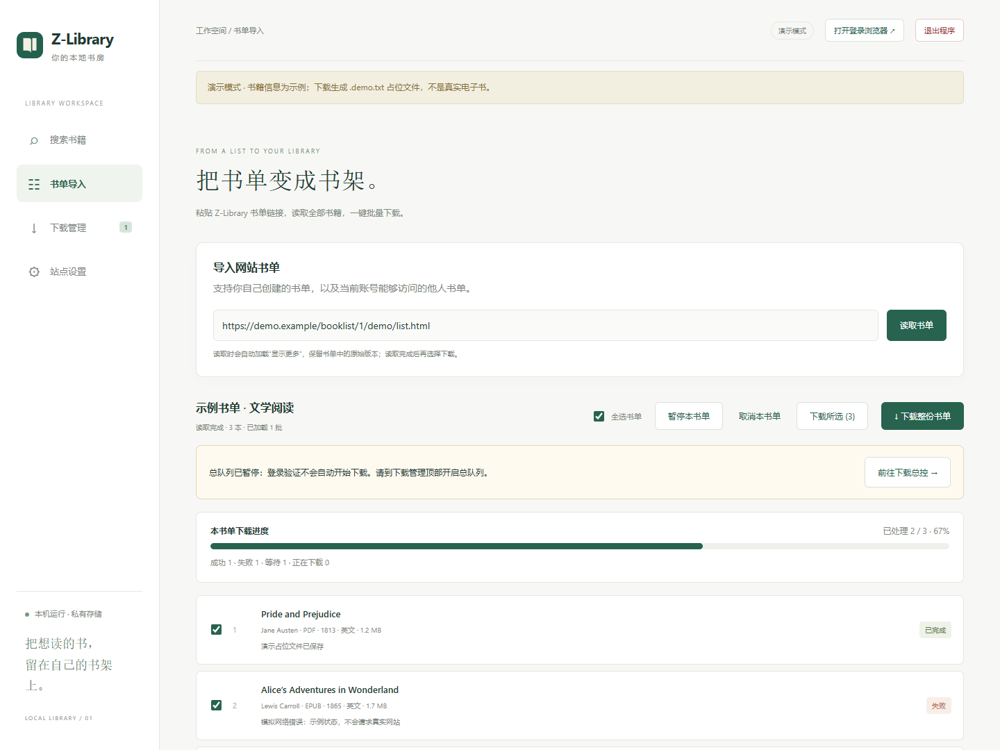
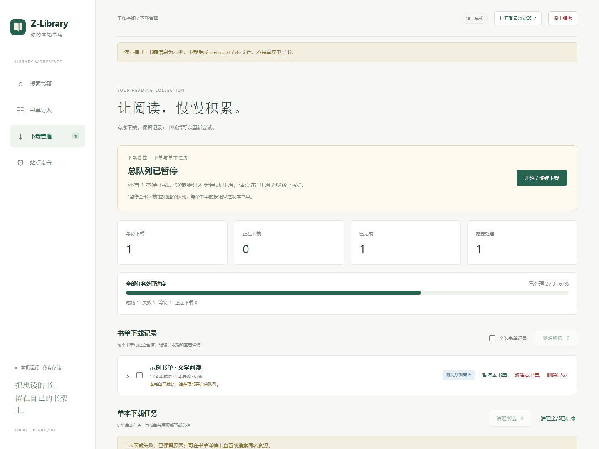
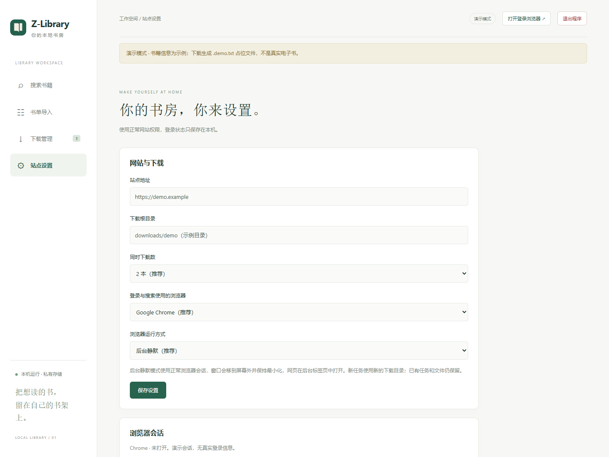

# 从书单到本地书库：一个下载工具的设计

Z-Library 提供按主题整理的书单。对于有权获取的内容，书单能省去反复搜索的时间，但逐本打开网页、点击下载、等待保存，依然很繁琐。网站也有自己的登录要求与下载额度，具体规则会变化，应以网站当前页面为准。

这个非官方本地工具要解决的，就是那些重复操作：在已有访问权限内，把书单加入可管理的队列，看到每一本的结果，并按主题整理文件。它不绕过验证或额度，仓库也不提供电子书。

## 想清楚目的，再设计按钮

最初的目标不是「尽可能快地点下载」，而是四件事：

- 可以一次导入书单。
- 下载失败有原因，其余任务不被拖住。
- 重试不重复保存、不覆盖完整文件。
- 关闭网页后仍可处理，重新启动时能保留记录。

用户可以直接搜索，也可以粘贴自己能访问的书单。浏览器负责登录与验证，工具不要求填写账号密码。

## 怎样把书单交给电脑处理？

浏览器擅长理解网页和维持会话，Node.js 更适合持续接收文件、检查大小和保存到磁盘，所以把两者分工：浏览器找到文件请求，本地程序处理文件流；必要时用独立的 Chrome 响应流回退。

多个书单可以分别暂停。每份书单复用同名文件夹，文件命名为「书名(作者)-年份」，让日后查找更容易。

## 几个容易讲清楚的坑

### 看起来正在保存，其实结果还没确认

「按钮点下去」不代表文件已经到达。工具现在显示实际接收字节，先写临时文件，完成后再变成最终文件。接收中断时清理临时产物，不能让残缺文件冒充完整电子书。

### 长书单的空页不一定是结束

有些分页会暂时返回空数据，但后面还有页。工具要看明确的分页信息，检查页码是否前进，而不是看到空页就停止。读取不完整时保留已读结果并提示原因，不装作「全部完成」。

### 点击继续，却仍然等待

总队列和单书单是两层开关。如果按钮埋在「单本任务」下面，用户很容易以为它只影响单本。因此总控移到下载管理顶部，书单按钮明确写「暂停本书单」。总暂停时，局部恢复显示「解除本书单暂停」，提示还需开启总控。

### 同名同大小，不一定是同一个文件

网页大小可能经过四舍五入，文件也可能损坏。程序综合检查名称、大小和格式签名；无法确认时保守保留，不替用户自动删书。清理历史记录也不删除电子书。

## 结果如何呈现？

现在，用户能看到每本书是排队、传输、保存还是失败，也能区分书单暂停与总队列暂停。并发数和保存目录可配置，出错有明确记录，重复操作可以复用已有结果。

配套测试覆盖队列、分页、取消、超时、代理回退和界面；测试通过不等于网站今天仍然可用。真实下载速度受资源、网络和代理影响，不能承诺每本都快，也不能用成功一本证明整个批量流程可靠。

这次设计最重要的收获是：一个好用的工具不仅要能开始，还要让人知道它什么时候结束、为什么失败，以及下一次操作会发生什么。
